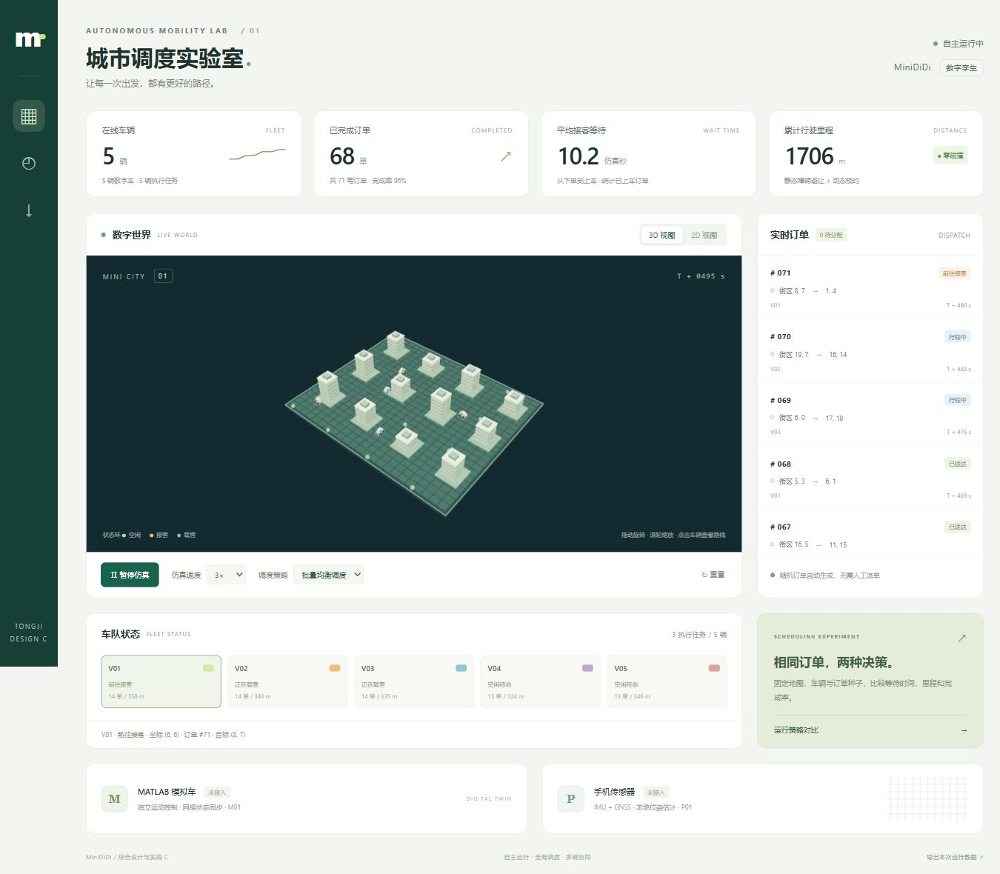
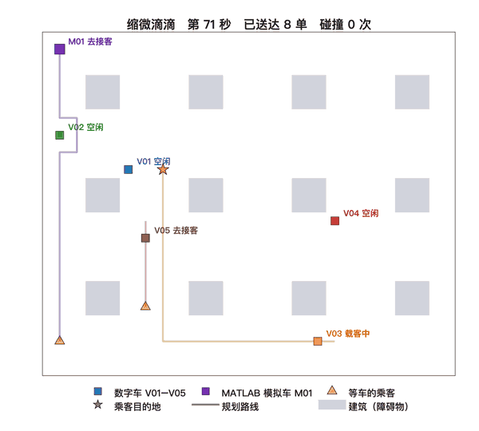

# MiniDiDi 缩微滴滴

同济大学《综合设计与实践 C》课程项目：模拟一个无人出租车系统。乘客随机叫车，服务端调度 5 辆数字车接送，网页用 3D 实时显示。MATLAB 模拟车和手机也可以作为车辆接入，与数字世界同步。



## 功能

- **数字世界**：23×19 栅格地图，5 辆车自动接单、送达
- **调度**：最近空车 / 匈牙利算法批量分配，可对比
- **寻路**：A* 加时空预约，车辆互不碰撞
- **3D 展示**：Three.js，不支持 WebGL 时切换 2D
- **MATLAB 车 M01**：差速模型 + 航向控制，与服务端同步位姿并参与接单
- **手机 P01**：Android App，用惯性传感器估计位姿并上传

## 运行演示

5 辆数字车（V01–V05）和 MATLAB 模拟车（紫色 M01）同时运行：黄色三角是等车的乘客，五角星是乘客目的地，彩色线是车辆规划的路线。动图为 1.5 倍速，记录了 M01 从接单、接到乘客到送达的完整过程，全程无碰撞。



## 运行

```bash
cmake -S . -B build -DCMAKE_BUILD_TYPE=Release
cmake --build build
./build/minididi --host 0.0.0.0 --port 8080 --web web
```

打开 <http://localhost:8080>。Windows 可双击 `启动演示.cmd`。

MATLAB 车：进入 `clients/matlab`，运行 `run_twin('http://服务端IP:8080')`。

手机：用 Android Studio 编译 `clients/android`，在 App 中填入服务端地址。

## 目录

```text
server/           C++ 服务端
web/              网页界面
clients/matlab/   MATLAB 模拟车
clients/android/  Android App
docs/             接口、架构、分工
```

## To Do

**已完成**

- [x] 数字世界：5 辆车自动接单送达，两种调度策略，A* 寻路且无碰撞（`server/`）
- [x] 3D 网页展示（`web/`）
- [x] MATLAB 模拟车：已在 MATLAB R2026a 上实测，能接单、送达，0 碰撞（`clients/matlab/`）
- [x] 运行演示动图（`docs/assets/matlab_demo.gif`）
- [x] 两种调度策略的对比数据（`experiments/`）
- [x] Android App 代码（`clients/android/`）

**待完成**

- [ ] 手机 App 真机测试
- [ ] 服务端、MATLAB、手机三端一起联调
- [ ] 技术报告、介绍 PPT（正文 ≤ 5 页）、演示视频（≤ 5 分钟）
- [ ] 第 8 周中期检查，第 16 周期末汇报

**写报告用的资料**

| 内容 | 位置 |
| --- | --- |
| 接口说明 | `docs/API.md` |
| 系统架构与算法（调度、寻路、MATLAB 控制） | `docs/ARCHITECTURE.md` |
| 调度策略对比数据 | `experiments/` |
| 运行截图与演示动图 | `docs/assets/` |
