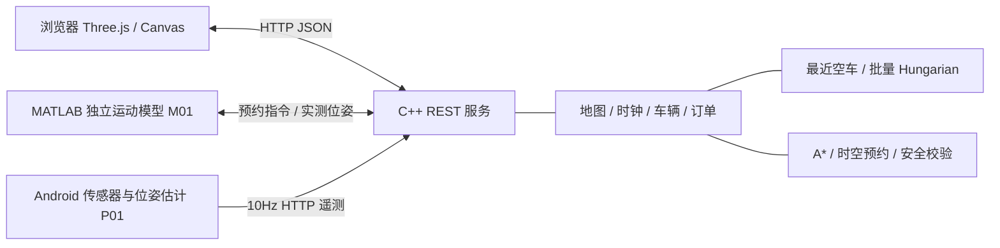

# 系统与算法说明

## 结构



服务端每 20ms 检查一次墙钟，以 `speed` 累积仿真步；每个完整 tick 表示 1 个仿真秒，数字车每步最多行驶一个格子，每格 1m。改变播放速度影响墙钟演示速度，不改变固定工作负载的 tick 度量。HTTP 回调和世界状态更新共用互斥锁；基准实验新建两份 World，不改变正在演示的世界。

## 地图与状态机

地图为 23×19。每隔六格放置 2×2 静态建筑，留下多通路道路，障碍格不能作为起终点。坐标原点在地图左上，x 向右、y 向下；三维展示中地图 y 映射到 z。

订单：`waiting → assigned → onboard → completed`。车辆：`idle → pickup → occupied → idle`。车辆到达上车点后自动更换目标为下车点；到达下车点后累计完成数，并释放当前订单。初始化生成固定的 80 笔随机需求，到达时刻为 0、7、14…553 tick。现场演示模式随后循环复用这组需求的起终点；有限基准模式只运行这 80 笔订单。随机流不受策略分支影响。

## 两种调度

`nearest`：按订单到达顺序，选静态道路最短路到上车点最近的空闲在线车辆。每次分配移除该空车，避免同一轮重复派单。

`balanced`：每轮取最多 20 笔最早未分配订单，对空闲在线车辆构造代价矩阵：

```text
cost(vehicle, order) = pickup_distance
                     + 0.35 * trip_distance
                     + 3.0 * vehicle_completed_orders
                     - 0.15 * order_wait_ticks
```

用 Hungarian 算法求当前矩阵的最小代价匹配，加入高代价虚拟订单处理空车多于订单的情况。代价中的等待时间让长时间未分配的请求更有机会入选，完成次数项用于订单少于空车时减少总派给同一辆车的情况；这些项在所有行/列都必须匹配时可能只产生常数偏移，不能解释成每次都改变匹配结果。此算法优化的是当前批次的启发式代价，不保证长期平均等待或总里程全局最优。

## 寻路与安全

静态 A* 使用四邻接单位代价、Manhattan 启发式。它提供静态地图上的最短路距离。

动态规划在 `(time, cell)` 上运行 A*，允许等待，预约窗口为 56 步。每轮先保守占据所有车辆当前格，再按阻塞次数和轮转优先级逐车规划。检查目标时还要保证目标在窗口剩余时间内可安全停留。预约表禁止相同时刻占据同格，以及沿相反方向交换同一条边。每步只执行首个动作，下步重新规划。

安全检查独立于路径搜索，并在 Release 编译中保持启用：所有车辆下一个位置必须是道路、互不重叠、没有边交换。发生内部不一致会暂停仿真并记录错误，而不继续展示碰撞后的状态。有限窗口、优先级规划在任意地图上没有完备性保证；本项目宽路网和已测工作负载能完成全部任务，不能据此声称解决任意多车死锁问题。

## MATLAB 控制与权限

M01 注册为第六辆城市车辆。服务端只给它一个相邻、未被占据的安全端点，并一直保留起点与端点，直到收到实际到达回报。其他车不能穿过它正在使用的路段。MATLAB 通过

```text
x' = v*cos(yaw), y' = v*sin(yaw), yaw' = omega
```

独立积分差速模型。先旋转，再前进；比例航向控制与限速使轨迹保持在预约通道内。服务端拒绝越出通道、错误指令号和倒序网络包。允许“新指令发出时仍在传输中的旧静止心跳”返回新指令，避免网络竞争导致反复注册。

5 秒无消息即断线，保留其位置与当前端点，不将真实未完成运动改为服务端代走。重新注册回到最后接受的连续位姿。此机制优先保证安全，设备断线占位可能降低系统吞吐量。

## 手机坐标与估计

P01 的 ENU 坐标以连接前设定的原点为参考：east 向东、north 向北，单位 m；yaw 使用 Android 方位角（从北顺时针）。旋转向量经 Android SensorManager 转换为设备到世界的旋转矩阵；线性加速度旋转后积分水平速度和位置，静止超过阈值时执行零速修正。无旋转向量时尝试重力与地磁姿态，无线性加速度时用低通重力估计做差分。

有效 GNSS 使用小增益校正，精度差于 20m 的读数不参与估计。缺失传感器不伪造数据质量；纯积分存在漂移、磁干扰与设备差异，适用于短时原型演示。手机不是自主机器人，在单独实验区同步，不能把携带手机的人宣称为自动完成城市接送任务的车辆。
